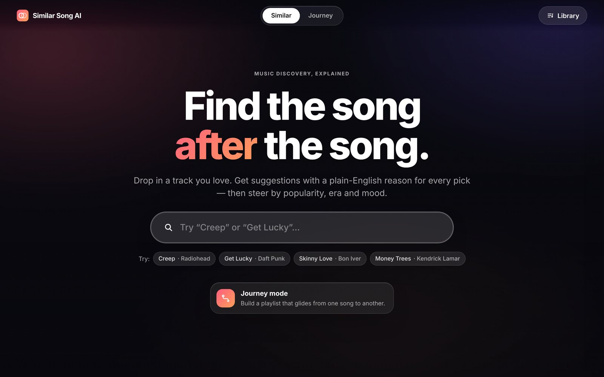
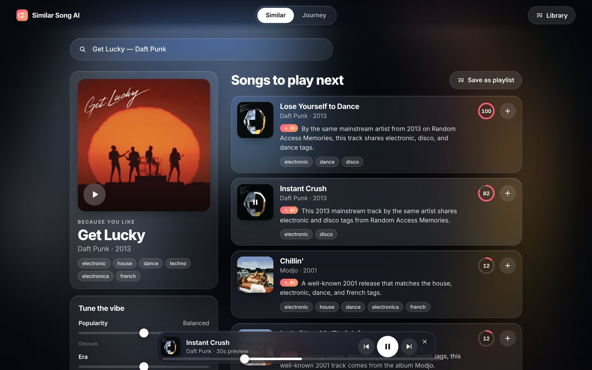
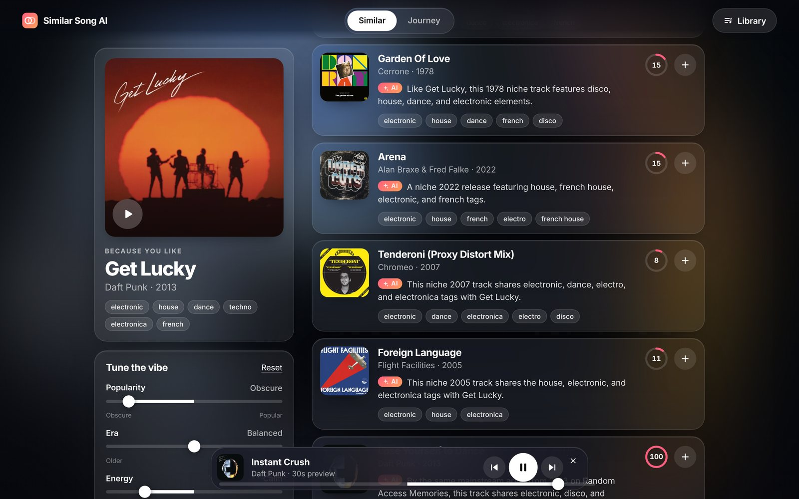
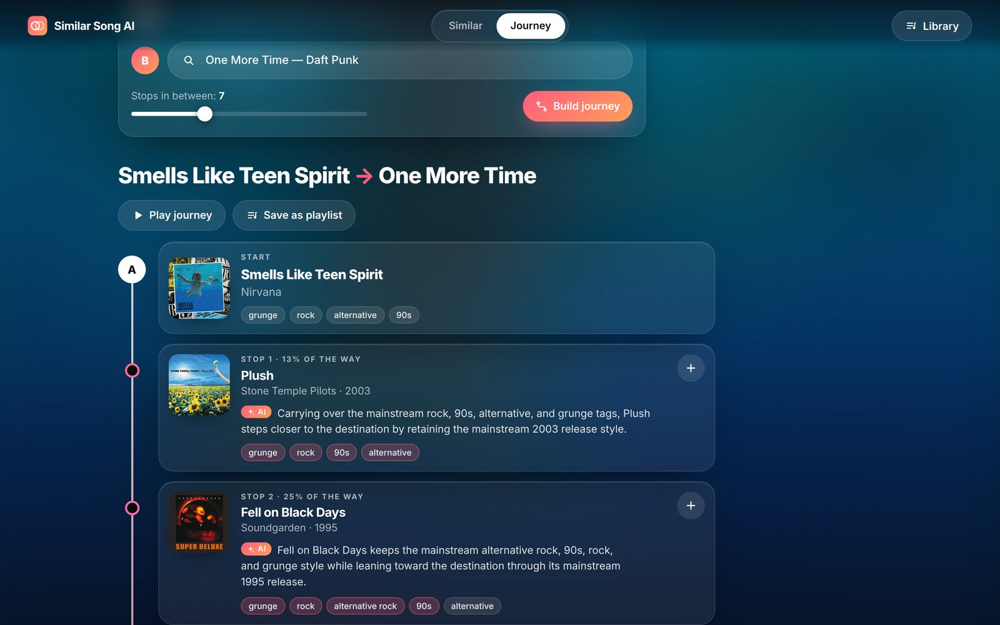
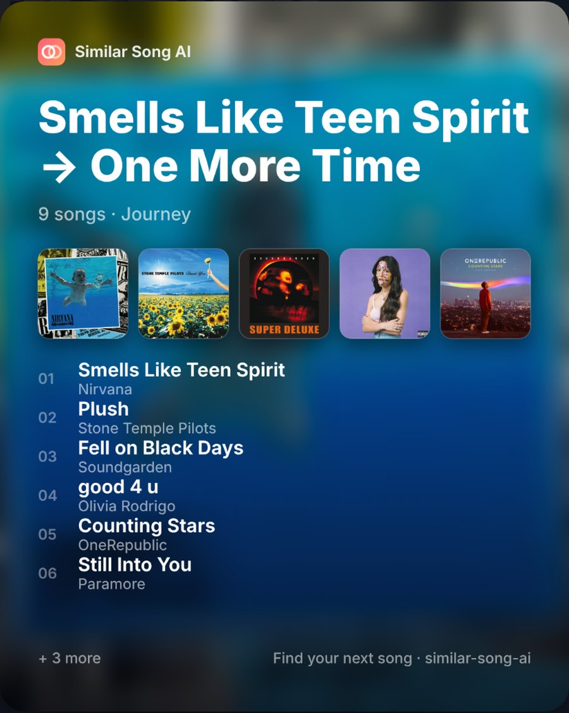
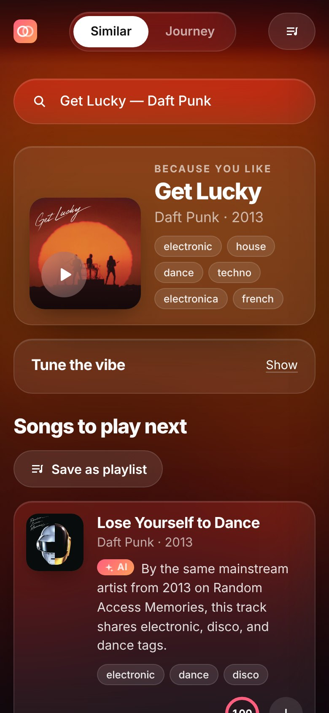
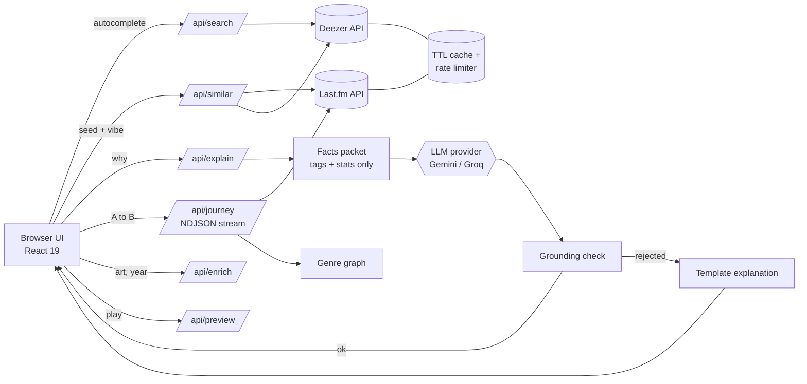

<div align="center">

# Similar Song AI

**Type a song you love. Get what to play next — and exactly why.**

Similar-song discovery with plain-English explanations grounded in real tags, vibe controls, a journey mode that glides from one song to another, and shareable playlist cards.



</div>

## Screenshots

| Suggestions with “why” | Vibe controls |
| --- | --- |
|  |  |
| **Journey mode** | **Share card** · **Mobile** |
|  |   |

> Real captures from the running app (live Last.fm + Deezer + Gemini). No animated GIF yet — see the roadmap.

## Features

- **Fast autocomplete** (Deezer search, debounced, keyboard-navigable combobox) with artwork.
- **Similar songs** from Last.fm listening data blended with weighted tag overlap, with artwork and playable 30 s previews.
- **“Why it’s similar”**: one sentence per suggestion written by an LLM that is given *only* the retrieved tags/metadata. Output is validated (numbers, names, cited evidence); anything that doesn’t check out falls back to a deterministic tag-based sentence. Cited tags are highlighted.
- **Vibe controls**: obscure ↔ popular, older ↔ newer, calm ↔ intense, plus mood chips (chill, dreamy, dark, …) derived from tags.
- **Journey mode**: pick songs A and B and get a playlist that drifts gradually between them, even across genres (genre-route planner + tag-space interpolation), with streamed progress.
- **Library**: collect picks, save playlists locally (`localStorage`), play them back, and **generate a shareable 4:5 card image** (PNG download / native share).
- **Blurred-artwork backdrop** that crossfades to whatever is playing, glass surfaces, reduced-motion support, mobile layout.
- **Runs without keys**: mock mode (bundled catalogue) and template explanations, so the app always works end to end.

## Tech stack

Next.js 16 (App Router) · React 19 · TypeScript · plain CSS (glass / backdrop-filter) · Vitest · ESLint.
Data: Last.fm API (server-side only) and Deezer public API. LLM: Gemini and Groq free tiers behind a tiny provider abstraction.

## Architecture



More detail (ranking formula, caching, grounding rules, decisions) is in [`developer.md`](developer.md).

## Getting started

```bash
npm install
cp .env.example .env.local   # optional: add keys
npm run dev                  # http://localhost:3000
```

| Variable | Purpose |
| --- | --- |
| `LASTFM_API_KEY` | Similarity + tags ([get a free key](https://www.last.fm/api/account/create)). Missing ⇒ demo mode |
| `GEMINI_API_KEY` / `GROQ_API_KEY` | LLM explanations ([Gemini](https://aistudio.google.com/apikey), [Groq](https://console.groq.com/keys)); optional |

Scripts: `npm run check` (typecheck + lint + tests) · `npm run build` · `npm start`.

Deploying on Vercel’s free tier: import the repo, add the env vars, deploy. Details in `developer.md`.

## Roadmap

- Shareable playlist links, multi-seed taste mixes
- MusicBrainz enrichment for exact release dates
- Persistent cache (KV) for serverless, e2e tests in CI
- Animated demo GIF

Music data © Last.fm and Deezer; previews are 30-second clips served by Deezer. This project is not affiliated with either service.
